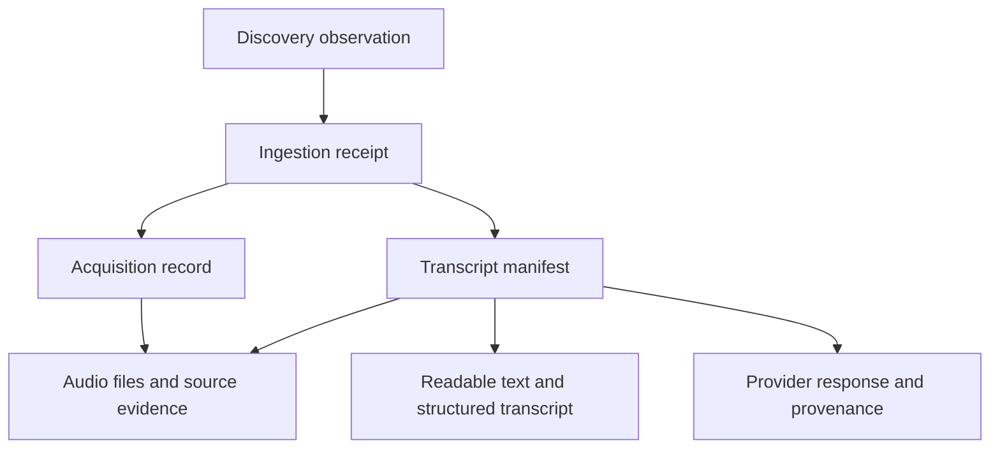

Our `sports-transcription` R2 bucket is the private archive for downloaded press-conference audio, transcripts, source evidence, and recovery backups. A single recording is represented by several linked objects: the audio itself, the transcription result, and JSON records explaining where they came from and how they were produced.

**Start with the season index or a transcript manifest when looking for a recording.** Those records point to the correct files; browsing audio hashes directly is rarely useful. This guide describes the live folder layout checked on October 20, 2026.

# The bucket and its top level

The bucket currently contains one top-level prefix: `dev/`. Despite the name, this is where our real working corpus lives, including the 2025–2026 Boston backfill. It is not disposable test data. There is no `prd/` prefix in the current listing.

R2 stores objects identified by a **key**, which is their full path-like name. The folders shown in its browser are groups of objects sharing a prefix.

| Term | Example | Meaning |
| - | - | - |
| Bucket | `sports-transcription` | The storage container |
| Environment prefix | `dev/` | Prepended to this application's object keys |
| Relative key | `audio/original/<hash>.mka` | The form stored in our manifests and used by the application |
| Full R2 key | `dev/audio/original/<hash>.mka` | The form visible in the bucket browser |

The application adds `dev/` automatically. When following a manifest reference in the R2 browser, prepend it once. When supplying a relative key to the application, do not prepend it again. Angle-bracket placeholders such as `<hash>` in this guide illustrate a pattern; they are not literal object names.

# Where things live

All paths below sit inside `dev/`.

| Location | What it contains | When you need it |
| - | - | - |
| `manifests/` | Published transcript records, organized by team, media ID, and run ID | Find the files and provenance for a transcription |
| `media/` | Per-recording transcript JSON, readable text, sanitized provider responses, receipts, and transcription provenance | Read or inspect the transcription result |
| `audio/` | Preserved audio, standardized audio, captions, and source metadata | Listen to a recording or inspect its source |
| `acquisitions/` | Download and audio-preparation records, organized by team and media ID | Check which audio was acquired and how it was validated |
| `discovery/` | Source responses, observations, configuration snapshots, and discovery-run reports | Understand how a candidate recording was found |
| `ingestions/` | Receipts linking a selected discovery item, policy, acquisition, and transcript | Trace a recording through the connected pipeline |
| `ingestion-batches/` | Reports for groups of requested ingestions, including completed, skipped, and failed outcomes | Investigate what happened in a batch |
| `policies/acquisition/` | Snapshots of the source and uploader policy used for ingestion | Check the authorization context attached to a receipt |
| `evaluation/` | Evaluation plans, screening evidence, review material, preview clips, and preparation records | Revisit evaluation and human-review evidence |
| `decisions/paired-v1/` | Saved evidence for the paired provider-comparison decision | Revisit the provider choice |
| `production-pilots/bos/` | Reports from bounded Boston production-pilot runs | Inspect pilot results rather than the whole season |
| `backups/` | Operational database snapshots, their manifests, and retention-test objects | Recover the worker's job history |

Discovery, evaluation, and pilot records are evidence about work. Their presence does not by itself mean a recording has a completed transcript or has passed human review.

# How a recording is connected

A **manifest** is a JSON record that acts as the contents page for a published transcription. Its references contain the target object's `key`, `sha256` checksum, and byte length. The checksum lets the application verify that it retrieved the expected bytes.



The usual transcript-manifest path is:

```text
manifests/bos/<media-id>/<run-id>.json
```

Some filenames also include a `-normalization_<hash>` suffix. This identifies a version of the conversion from provider output into our common transcript format. It can represent reuse of an existing paid result rather than another provider submission.

Inside the manifest, these are the most useful fields:

| Field | Follow it to find |
| - | - |
| `media.sources` | The original source page and source identifier |
| `run.provider` and `run.model` | The transcription service and model |
| `run.normalized` | Structured transcript JSON in our common format |
| `artifacts.readable` | Plain text with timestamps and speaker labels |
| `artifacts.audio` | Preserved original-codec audio |
| `artifacts.derivative` | Standardized audio derivative |
| `run.raw` | The provider's sanitized response |
| `artifacts.provenance` | Processing settings, timing, usage estimates, and acquisition reference |

“Normalized” has two different meanings here: `audio/normalized/` is standardized audio, while `run.normalized` is standardized transcript JSON.

# Audio and transcript file formats

The audio area has four current subfolders:

- `audio/original/<hash>.mka`: the original audio codec preserved in a Matroska audio container. This is audio, not a retained full video.

- `audio/normalized/<hash>.flac`: a mono, 16 kHz FLAC derivative. The acquisition process does not remove silence or denoise it.

- `audio/captions/<hash>.txt`: separately collected subtitle or caption evidence. These are not the output of our transcription provider.

- `audio/source/<hash>.json`: source metadata and acquisition evidence.

Transcription artifacts generally follow `media/<media-id>/<kind>/<hash>`. Useful kinds include `transcript`, `readable`, `provider-raw`, `provider-receipt`, and `transcription-provenance`.

**Many objects under `media/` have no filename extension.** A `readable` object is still plain text, and a `transcript` object is still JSON. Follow the manifest and artifact kind to identify the format. Local exports add convenient `.txt` and `.json` filenames.

The long names are deliberate. A file hash identifies its contents; `media_…` identifies a recording revision; `run_…` identifies a transcription request and its settings. Identical audio bytes can share a stored audio object. Separate uploads are not automatically treated as the same interview just because their titles or dates match.

# Find and read a transcript

For the completed season backfill, use the [season manifest index](https://github.com/pregan716/sports-transcription/blob/3e9636f5755daf6526e77a3be21aa8b885d425ff/docs/evidence/season-backfill/manifest-index.json). Each entry includes a title, source URL, publication day, and exact `manifestKey`.

For example, the index contains **Joe Mazzulla REACTS to Al Horford LEAVING Celtics**, source video `9ke5bKV86RU`, published October 1, 2025. To inspect it:

1. Find that video ID in the season index and copy its complete `manifestKey`.

2. In the `sports-transcription` bucket, open `dev/` followed by that key.

3. Read `artifacts.readable.key` in the manifest.

4. Open `dev/` followed by that referenced key to retrieve the text. Use `run.normalized.key` instead for structured JSON, or `artifacts.audio.key` for audio.

For a convenient local reading copy, run this from the repository with its configured Doppler access:

```sh
doppler run --no-fallback -- npx tsx scripts/export-season-backfill.ts docs/evidence/season-backfill/manifest-index.json data/season-transcripts
```

Open `data/season-transcripts/README.md` afterward. The export reads existing R2 objects; it does not submit transcription jobs. It preserves matching existing exports and refuses to silently overwrite different local content.

The October 19 backfill index contains **134 recordings: 111 newly transcribed and 23 reused**. This is an explicitly selected season corpus. A bucket-wide listing also includes older tests, comparisons, and versions.

# Interpret dates and versions correctly

A source's publication time, the time the interview actually occurred, the time we discovered it, and the time it was transcribed are separate facts. Publication dates organize the season export; they do not certify the event date. The bucket is organized primarily by identity and artifact type, not by game date.

Likewise, `speaker_A` or `speaker_B` means a voice cluster assigned by the provider. It does not establish that the speaker is Joe Mazzulla or identify a reporter. Human review evidence is separate from the provider transcript.

One recording may have several provider runs, transcript versions, or normalization manifests. **Counting manifest files is not a reliable way to count distinct recordings**, and the latest filename or upload time is not a rule for choosing the preferred version. Use the explicit season index or the relevant reviewed selection.

Published objects are designed to be immutable: new evidence and versions get new objects, rather than editing the original bytes. Read related receipts and review history when determining current status; do not rename or reorganize bucket objects as if they were ordinary local folders, because other records reference their exact keys.

# Backups and the live database

The active job database is on the EC2 worker at `/srv/sports-transcription/jobs.sqlite`. It tracks work in progress, provider job handles, reservations, and completion history. R2 stores snapshots of that operational database alongside the durable corpus.

| Backup location | Purpose |
| - | - |
| `backups/databases/<destination>/<hash>.sqlite` | A consistent SQLite snapshot |
| `backups/manifests/<destination>/<hash>.json` | The snapshot reference, timestamps, checksums, and state summary |
| `backups/retention-probes/` | Objects used to test retention behavior, not recovery snapshots |

The `r2_…` destination identifier binds a snapshot to its R2 endpoint, bucket, and prefix. It is not a team or recording ID. For recovery, select a backup manifest and follow the [backup runbook](https://github.com/pregan716/sports-transcription/blob/3e9636f5755daf6526e77a3be21aa8b885d425ff/docs/operational-backups.md); a database object without its published backup manifest is not a completed backup.

Transcript manifests can help reconstruct a corpus index, but they cannot reconstruct every in-flight provider request or spending reservation. That is why we retain both corpus artifacts and operational backups.

# Quick lookup and references

| I want to… | Start here |
| - | - |
| Read the season transcripts | Season index or generated local `README.md` |
| Listen to one recording | Its manifest → `artifacts.audio` |
| Inspect words, timestamps, and speaker labels | Its manifest → `run.normalized` |
| See the provider's response | Its manifest → `run.raw` |
| Understand a download or audio-validation issue | `acquisitions/` and `audio/source/` |
| Investigate a missing or skipped item | Discovery report and ingestion-batch report; use the live job database for operational state |
| Revisit screening or provider selection | `evaluation/` and `decisions/paired-v1/` |
| Recover the worker | `backups/manifests/` and the backup runbook |

Bucket access requires authorized Cloudflare or application credentials. An object key is not a public download URL. Credentials are supplied through Doppler, not stored as files in the corpus; short-lived provider audio URLs are not stable links to share.

The live listing above is narrower than every prefix the code supports. For example, code can also publish `reviews/`, `benchmark/`, `pilot-reports/`, and temporary `setup-checks/` objects; these were absent from the top-level `dev/` listing when this guide was checked.

Implementation and operational references: [manifest and export behavior](https://github.com/pregan716/sports-transcription/blob/3e9636f5755daf6526e77a3be21aa8b885d425ff/src/corpus.ts), [R2 prefix handling](https://github.com/pregan716/sports-transcription/blob/3e9636f5755daf6526e77a3be21aa8b885d425ff/src/storage.ts), [audio acquisition](https://github.com/pregan716/sports-transcription/blob/3e9636f5755daf6526e77a3be21aa8b885d425ff/docs/acquisition.md), and [season backfill results](https://github.com/pregan716/sports-transcription/blob/3e9636f5755daf6526e77a3be21aa8b885d425ff/docs/season-backfill.md).
